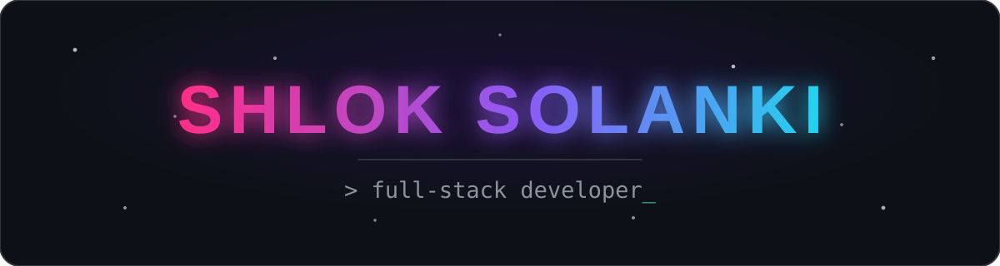
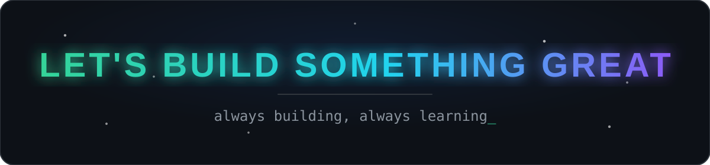

<p align="center">
  
</p>

<p align="center">
  
  
  
  
</p>

<p align="center">
  
</p>

---


```
✔ Identity verified........ SHLOK SOLANKI
✔ Coffee levels............ CRITICAL (as usual)
✔ Bugs squashed today...... ∞
✔ Sleep schedule........... NOT FOUND
✔ Vibe check............... IMMACULATE ✨
```

---


```typescript
const shlok: Developer = {
  name: "Shlok Solanki",
  role: "Full-Stack Developer & Team Lead",
  location: "India 🇮🇳",
  stack: ["React", "Next.js", "Node.js", "MySQL", "MongoDB", "Python"],
  currently: "Leading 9 devs on a College Feedback Portal",
  sideQuests: ["SIH 2026 grind", "Hackathons", "Open Source"],
  motto: "Code. Create. Learn. Repeat.",
  hireable: true,
};
```

- 🔭 **Right now:** building a full **College Feedback Portal** — Node + Express + MySQL + React, team of 9
- 🌱 **Leveling up:** Next.js · System Design · SIH 2026
- 💬 **Ping me for:** React, Node, MySQL — or why your code broke at 3 AM
- 🎯 **2026 goal:** ship stuff people actually use
- ⚡ **Fun fact:** my GitHub streak fears me, not the other way around

---


<p align="center">
  
</p>

<p align="center">
  
  
  
  
  
</p>

---


<p align="center">
  
  
</p>

<p align="center">
  
</p>

<p align="center">
  
  
</p>

---


<p align="center">
  
</p>

---


<p align="center">
  
</p>
<p align="center">
  
</p>

---


<p align="center">
  <a href="https://discord.gg/phe0n1xx."></a>
  <a href="https://linkedin.com/in/shlok-solanki-ba4786395"></a>
  <a href="mailto:shlokpsolanki2020@gmail.com"></a>
</p>

<p align="center">
  👋
  <b>Thanks for scrolling this far — you're officially cool now.</b>
</p>



<p align="center"><i>Made with 💜, excessive caffeine ☕, and 0 hours of sleep</i></p>
